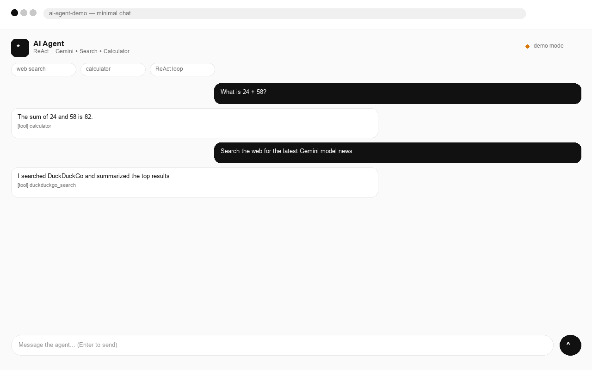
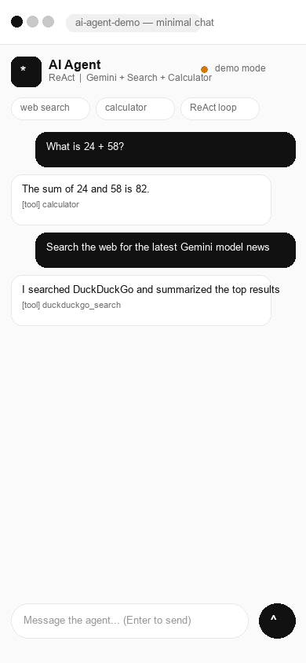
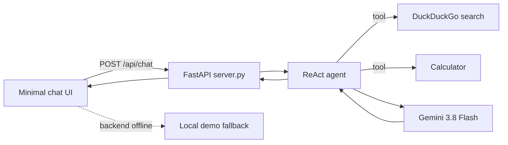

# AI-AGENTS-PYTHON — ReAct AI Agent + Minimal Chat Frontend

A Python ReAct agent (Gemini + DuckDuckGo search + calculator) with a clean,
minimal chat UI and a FastAPI backend. Open the frontend for an instant demo —
no API key needed. Connect the backend for live search + LLM answers.



> Live demo (frontend-only): enable GitHub Pages (docs below) →
> `https://ZIZ12007.github.io/AI-AGENTS-PYTHON/`

## What it does

- Chat UI sends a message to `POST /api/chat` and keeps the conversation history
- Backend runs a ReAct loop: Thought → tool → Observation → answer
- Tools: `duckduckgo_search` (live web), `calculator` (local arithmetic)
- UI shows which tools fired per reply, and reports backend errors instead of hiding them
- The backend serves the frontend, so the UI talks to the API on its own origin by default

## Repo map

```text
Project1/
  MAIN.PY              # CLI ReAct agent
  agent_core.py        # shared model + tools + streaming helpers
  server.py            # FastAPI wrapper (POST /api/chat, GET /api/health, serves frontend)
  requirements.txt     # backend deps
  test_agent.py        # offline smoke test (no API key needed)
  .env.example         # copy to .env and add your key
  frontend/
    index.html / styles.css / app.js   # minimal chat (demo fallback built in)
docs/
  screenshots/desktop.png / mobile.png
  PORTFOLIO.md         # copy-paste portfolio write-up
  LOOM-SCRIPT.md       # 60-second demo script
DEPLOY.md              # every hosting option (Vercel, Cloud Run, tunnel, ...)
```

## Run it

Frontend only (instant):

```bash
# just open in a browser
Project1/frontend/index.html
```

Full stack:

```bash
cd Project1
python -m venv .venv && source .venv/bin/activate   # Windows: .venv\Scripts\activate
pip install -r requirements.txt
cp .env.example .env        # Windows: copy .env.example .env
# .env -> GOOGLE_API_KEY=your_key_here  (free key: https://aistudio.google.com/apikey)
uvicorn server:app --port 8000
# open http://localhost:8000/
```

API:

```bash
curl -X POST http://localhost:8000/api/chat \
  -H "Content-Type: application/json" \
  -d '{"message":"What is 24 + 58?"}'
```

```json
{ "reply": "The sum of 24 and 58 is 82.", "tools_used": ["calculator"], "demo": false, "elapsed_ms": 913 }
```

Follow-up questions keep the context of the conversation — send the earlier
turns along with the new message (the last 12 turns are replayed):

```bash
curl -X POST http://localhost:8000/api/chat \
  -H "Content-Type: application/json" \
  -d '{
        "message": "And what tools does it have?",
        "history": [
          {"role": "user", "content": "What is a ReAct agent?"},
          {"role": "assistant", "content": "It loops thought/tool/observation."}
        ]
      }'
```

Health check:

```bash
curl http://localhost:8000/api/health
# {"ok":true,"has_key":true,"model":"gemini-3.8-flash","tools":["calculator","duckduckgo_search"], ...}
```

| Response field | Meaning |
| --- | --- |
| `reply` | the answer (or the reason the agent could not answer) |
| `tools_used` | the tools that fired, e.g. `["calculator"]` |
| `demo` | `true` when the server has no API key, `false` when the agent ran |
| `error` | `true` when the agent failed or timed out |
| `model` | the model that answered (see the fallback chain below) |
| `elapsed_ms` | how long the run took |
| `cached` | `true` when the answer came from the cache (no API call) |

### Streaming

`POST /api/chat/stream` returns the answer as server-sent events, so the UI
shows the text while it is being written instead of waiting for the whole
turn:

```
event: delta
data: {"text":"The sum of "}

event: delta
data: {"text":"24 and 58 is 82."}

event: done
data: {"reply":"The sum of 24 and 58 is 82.","tools_used":["calculator"],"elapsed_ms":2410}
```

The plain `POST /api/chat` is unchanged and still works.

### Speed

The free Gemini tier is slow and inconsistent, so the server works around it:

- **The fastest model wins.** `gemini-3.5-flash` answers a full ReAct turn
  (two model calls) in **2.5–4s**; other models on the same key regularly take
  30–100s. It is the default now.
- **Measured, not guessed.** The server remembers how long each model took
  and puts the slow ones at the back of the queue. A model that exceeds
  `SLOW_MODEL_SECONDS` (default 8) is parked for `SLOW_MODEL_COOLDOWN`
  seconds (default 10 minutes) instead of being paid for on every request.
- **A model gets a time limit.** `MODEL_ATTEMPT_SECONDS` (default 15) is how
  long one model may take before the next one is tried.
- **No retry storms.** The Google SDK retries a failed request five times
  with a growing backoff, which turned a quota error into a 36 second wait.
  Retries are switched off in both the SDK and LangChain, so a quota error
  surfaces in about two seconds.
- **Repeat questions are free.** A question that was already answered comes
  from the cache (`CACHE_TTL`, default one hour) - no API call, no waiting.

### Model fallback

The Gemini free tier meters **each model separately** (20 requests/day) and
busy models answer `503 high demand`. So the server keeps a chain of models
and moves to the next one when the current one is rate limited or overloaded:

```
gemini-3.5-flash → gemini-3.7-flash → gemini-3.6-flash → gemini-3.1-flash-lite → gemini-3.8-flash
```

`GEMINI_MODEL` puts your own model first; the chain is reported by
`/api/health` as `model_chain`, and the measured latency per model as
`model_latency_ms`.

> The free tier is generous enough for a demo but not for real traffic - a
> ReAct turn costs two requests, so one model answers about ten questions a
> day. Enable billing in AI Studio for real traffic.

Offline smoke test (no API key required):

```bash
cd Project1 && python test_agent.py
```

## Configuration

| Variable | Default | Purpose |
| --- | --- | --- |
| `GOOGLE_API_KEY` / `GEMINI_API_KEY` | – | Gemini key |
| `GROQ_API_KEY` | – | Groq key (fastest free option) |
| `OPENROUTER_API_KEY` | – | OpenRouter key (one key, many models) |
| `CEREBRAS_API_KEY` | – | Cerebras key |
| `GITHUB_TOKEN` | – | GitHub Models key |
| `OPENAI_API_KEY` | – | OpenAI key |
| `PROVIDER` | first with a key | Force one: `groq`, `openrouter`, `cerebras`, `github`, `openai`, `gemini` |
| `AGENT_MODEL` | per provider | Override the model id |
| `GEMINI_MODEL` | `gemini-3.5-flash` | Model id when the provider is Gemini |
| `AGENT_TIMEOUT` | `120` | Seconds a single agent run may take |
| `MODEL_ATTEMPT_SECONDS` | `15` | Seconds one model may take before the next is tried |
| `SLOW_MODEL_SECONDS` | `8` | A model slower than this is parked for a while |
| `SLOW_MODEL_COOLDOWN` | `600` | How long a slow model is parked (seconds) |
| `CACHE_TTL` | `3600` | How long an answer stays cached (seconds) |
| `PORT` | `8000` | Port used by `python server.py` |

### Providers

The agent is not tied to Gemini. Any provider with an OpenAI-compatible API is
one integration (`langchain-openai`), so the ReAct loop, the tools, the
streaming and the cache all work the same:

| Provider | Key | Free tier | Speed |
| --- | --- | --- | --- |
| **Groq** | `GROQ_API_KEY` | generous RPM + daily quota | **fastest** (~1s) |
| **OpenRouter** | `OPENROUTER_API_KEY` | free models (`:free` suffix) | fast |
| **Cerebras** | `CEREBRAS_API_KEY` | free tier | very fast |
| **GitHub Models** | `GITHUB_TOKEN` | free with a PAT | fast |
| **OpenAI** | `OPENAI_API_KEY` | needs billing | fast |
| **Gemini** | `GOOGLE_API_KEY` | **20 requests/day/model** | 2.5–4s |

> The Gemini free tier is the reason this project felt slow: a ReAct turn
> costs two requests, so one model answers about ten questions a day.
> **Groq or OpenRouter removes that ceiling** — drop the key into
> `Project1/.env` and restart, nothing else changes.

> The free Gemini tier regularly takes 15–30s per model call, and a ReAct turn
> needs two of them (decide → answer). Keep `AGENT_TIMEOUT` comfortably above
> 60, or slow answers get cut off.

## Deploy a live site (pick one)

See **[DEPLOY.md](./DEPLOY.md)** for the full guide — Vercel (recommended,
free, no card), a Cloudflare Tunnel for a live URL straight from your PC,
Google Cloud Run, Render, or the frontend-only GitHub Pages demo.

**A. Frontend demo on GitHub Pages (free, 2 min)** — Settings → Pages → GitHub Actions, the workflow in `.github/workflows/pages.yml` publishes `Project1/frontend`. No key needed (demo mode). Point it at a hosted backend by setting one line in `Project1/frontend/config.js`.

**B. Full backend on Vercel (free, no card)** — `vercel.json` is ready. Import the repo, set `GOOGLE_API_KEY`, deploy. The API and the UI share one domain.

**C. Full backend on Render (free)** — `render.yaml` included:

```bash
# Render dashboard -> New -> Blueprint -> select this repo
```

Set env `GOOGLE_API_KEY`. The backend also serves the frontend, so
`https://<your-service>.onrender.com/` is a complete app — no extra
configuration needed.

**D. Vercel (frontend)** — `vercel.json` included:

```bash
npx vercel --prod
```

## Screenshots

| Desktop | Mobile |
| --- | --- |
|  |  |

## Stack

Python · LangChain v1 (`create_agent`) · LangGraph · Gemini (`gemini-3.8-flash`) · DuckDuckGo (`ddgs`) · FastAPI · Vanilla JS · GitHub Pages / Render

## Architecture



## Troubleshooting

| Symptom | Fix |
| --- | --- |
| `ImportError: Could not import ddgs python package` | `pip install -r requirements.txt` (the `ddgs` package provides the search backend) |
| `400 INVALID_ARGUMENT ... API key not valid` | wrong/missing key — set `GOOGLE_API_KEY` in `Project1/.env` |
| `404 models/gemini-2.0-flash is not found` | `gemini-2.0-flash` was shut down; the default is now `gemini-3.8-flash` |
| `GOOGLE_API_KEY is missing on the server` | the API returns `demo: true`; add the key and restart the server |
| Frontend loads but the page is unstyled | open the backend root (`http://localhost:8000/`) instead of `index.html` — the API serves `styles.css` / `app.js` |
| The header says "backend offline" on a deployed site | the Backend URL in ⚙ still points at `http://localhost:8000`. Press **Reset** to go back to the same-origin default (`/api/chat`) |
| The UI answers with a canned demo reply | the backend is unreachable. The error bubble above it names the URL that failed |
| A reply says "The agent failed while answering" | the server log has the traceback; the API only returns a safe summary |
| "The agent took longer than Ns" | the free Gemini tier is slow or rate-limited. Raise `AGENT_TIMEOUT` and retry |
